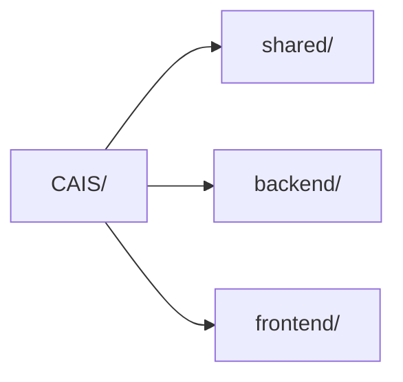
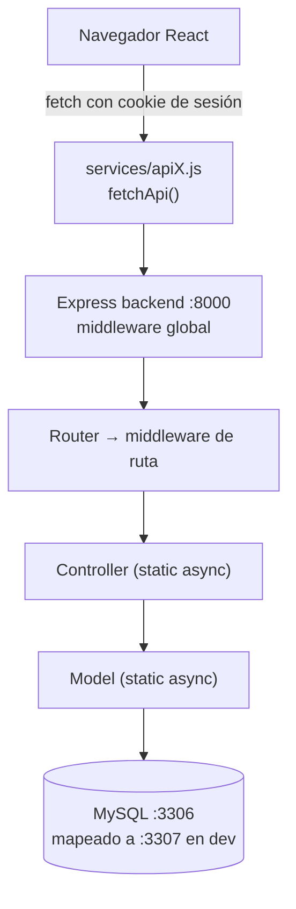
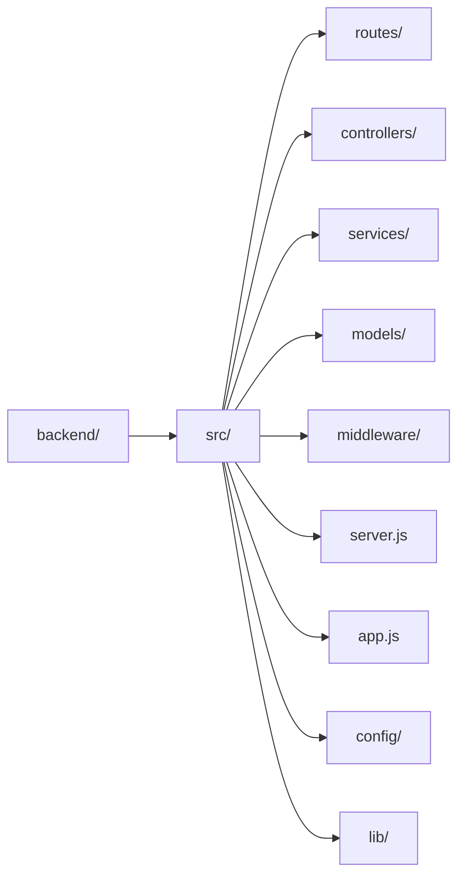
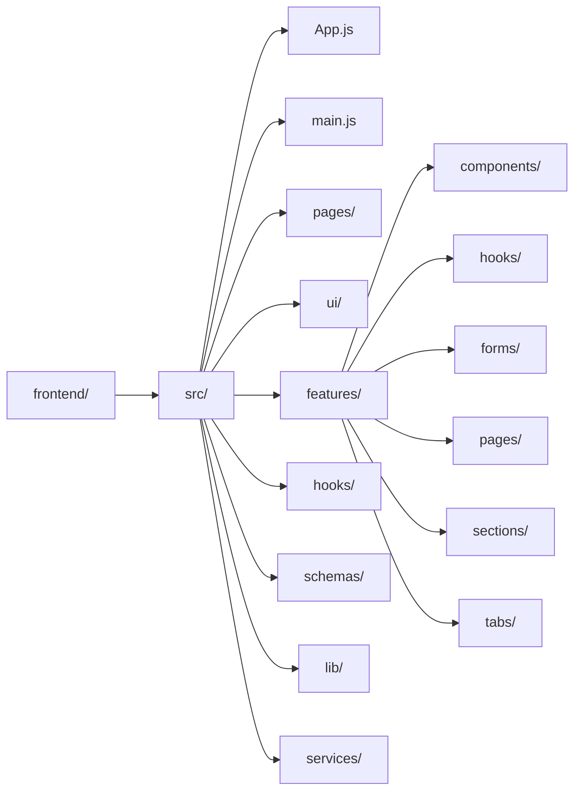

# 01 · Arquitectura

## El monorepo

CAIS es un monorepo **pnpm** con cuatro workspaces. Cualquier cambio cruza al menos uno; entender la separación es lo primero.



### Reglas duras

- **No duplicar schemas ni constantes** entre `backend/` y `frontend/`. Si algo lo necesitan los dos, vive en `shared/`. Si solo uno, vive en ese workspace.
- **`shared/` no tiene runtime propio.** No importa de `backend/` ni `frontend/`. Solo dependencias puras (Zod como peer). Se consume vía `"@cais/shared": "workspace:*"`.
- **JavaScript puro.** Cada workspace tiene `jsconfig.json` con paths para autocompletar. No se agrega TypeScript.
- **pnpm** obligatorio (el `preinstall` falla con npm/yarn).

## Qué vive en `shared/`

| Carpeta                                     | Contenido                                                             |
| ------------------------------------------- | --------------------------------------------------------------------- |
| `constants/users.js`                        | `ROLES`, `AREAS`, `ESTADOS`, `ACCIONES`, `ENTIDADES`, sort keys       |
| `constants/pagination.js`                   | `PAGE_SIZE`, `MAX_PAGE_SIZE`, `DEFAULT_PAGE`                          |
| `constants/patients.js`, `emergencies.js`   | Catálogos de dominio (selects, chips)                                 |
| `schemas/fields.js`                         | Validaciones de campo reutilizables (correo, teléfono, fechas, enums) |
| `schemas/*.js`                              | Schemas Zod por dominio (`users`, `password`, `invitations`, `audit`) |
| `schemas/medicina/*`, `schemas/nutricion/*` | Schemas segmentados por área                                          |

Se importan por el `exports` map del paquete, nunca por ruta relativa profunda:

```js
import { ROLES, AREAS } from '@cais/shared/constants/users'
import { validateEmergency } from '@cais/shared/schemas/medicina/emergency'
import { correoSchema } from '@cais/shared/schemas/fields'
```

## Cómo viaja una request



La respuesta regresa como JSON. Los errores no se atrapan con `try/catch`: se
lanza un `AppError` y un middleware central en `app.js` arma el body de error.
Ver [05 · API del backend](./05-api-backend.md).

## Estructura de carpetas

### backend/



### frontend/


