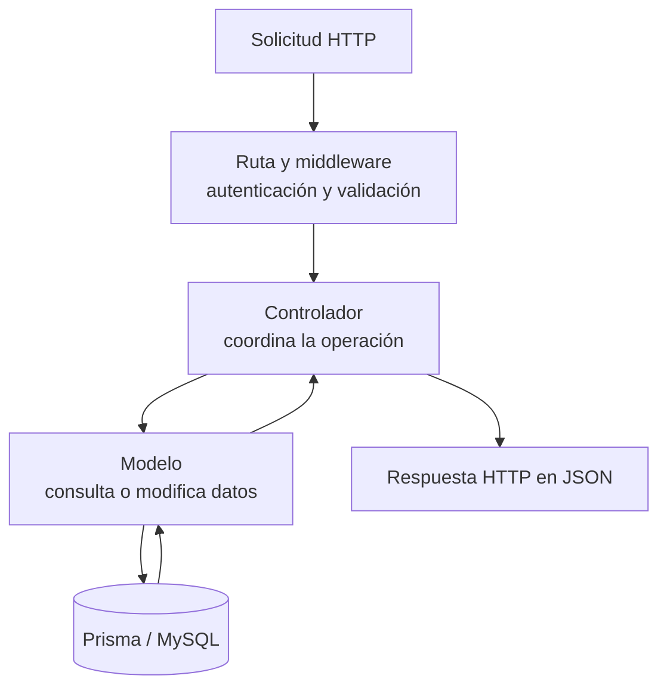

# API del backend

Esta guía explica cómo se organiza la API del backend, qué responsabilidad tiene cada capa y qué formato reciben los clientes. 

## Cómo se procesa una solicitud

Una solicitud pasa por estas capas. Cada una tiene una responsabilidad concreta:

| Capa           | Responsabilidad                                                  | Ejemplos de trabajo                                                    |
| -------------- | ---------------------------------------------------------------- | ---------------------------------------------------------------------- |
| `routes/`      | Define las rutas y conecta los middleware con los controladores. | Requerir autenticación, validar parámetros y elegir el controlador.    |
| `controllers/` | Coordina la operación y construye la respuesta HTTP.             | Ejecutar una transacción y registrar la auditoría de una modificación. |
| `models/`      | Consulta y modifica los datos mediante Prisma.                   | Convertir UUID, cargar relaciones y preparar los objetos de respuesta. |
| `lib/`         | Reúne funciones de apoyo reutilizables.                          | UUID, fechas, errores, paginación y filtros de consulta.               |

El recorrido habitual es:



La validación de entrada ocurre en el middleware de la ruta. El modelo se encarga de acceder a los datos y el controlador coordina la operación; así se evita duplicar responsabilidades.

### Rutas

Las rutas conectan cada método HTTP con su controlador. También aplican los middleware necesarios, como autenticación y validación:

```js
router.use(requireAuth)
router.route('/').get(C.getAll).post(validate(validateX), C.create)
router
  .route('/:id')
  .all(validateUuidParam())
  .get(C.getById)
  .patch(validate(validatePartialX), C.update)
  .delete(C.delete)
```

En este ejemplo, todas las rutas requieren autenticación. El parámetro `id` se valida antes de atender las operaciones sobre un recurso específico; el cuerpo se valida al crear o actualizar.

### Controladores

El controlador coordina la solicitud y devuelve la respuesta HTTP. Si una operación modifica datos y genera un registro de auditoría, ambas acciones se ejecutan dentro de la misma transacción:

```js
export class XController {
  static async create(req, res) {
    const created = await prisma.$transaction(async (tx) => {
      const item = await XModel.create(req.body, tx)
      await AuditModel.create(
        {
          usuario_id: req.session.userId,
          accion: ACCIONES.CREAR,
          entidad: ENTIDADES.X,
          objetivo_id: item.id,
          paciente_id: item.paciente_id,
        },
        tx
      )
      return item
    })
    res.status(201).json({ message: 'X creada', x: created })
  }

  static async getById(req, res) {
    res.json(await XModel.getById(req.params.id))
  }
}
```

Al implementar un controlador:

- No valides el cuerpo ni agregues `try/catch`. El sistema ya centraliza el manejo de errores, por lo que se duplicaria trabajo. Express 5 propaga los errores de funciones `async`, y la validación se realiza en el middleware, unificando el formato de respuesta.
- Deja que el modelo indique si el recurso no existe; `getById`, `update` y `delete` lanzan `NotFoundError` cuando corresponde.
- Para errores de la aplicación, lanza la clase `AppError` adecuada. El middleware central construye la respuesta HTTP.
- Ejecuta la modificación y su registro de auditoría en una sola transacción.
- Obtén del resultado del modelo los datos que se puedan derivar, como `paciente_id`, en lugar de confiar en valores enviados por el cliente.

### Modelos y formato de los datos

Los modelos son la capa de acceso a Prisma. Se encargan, entre otras cosas, de convertir UUID entre el formato interno y el formato que usa la API, cargar las relaciones necesarias y devolver los datos con `formatX`.

```js
function formatUser(u) {
  if (!u) return null
  const { estados, roles, ...rest } = u
  return { ...rest, id: bufferToUUID(u.id), estado: estados?.codigo, rol: roles?.codigo }
}

static async getById(id, tx = prisma) {
  const user = await tx.usuarios.findFirst({
    where: { id: uuidToBuffer(id), deleted_at: null },
    include: includeRelations,
  })
  if (!user) throw new NotFoundError('el usuario')
  return formatUser(user)
}
```

El modelo es el punto donde se decide que un recurso no encontrado produce un 404. Si modificas las relaciones de `include` o los campos de `select`, revisa también `formatX` y el código del frontend que consume esa respuesta.

Antes de insertar o actualizar, los modelos comprueban los conflictos de unicidad conocidos y lanzan `ConflictError` cuando encuentran uno.

## Formato de las respuestas

La API entrega los recursos como objetos planos. Los identificadores se devuelven como cadenas UUID y las relaciones se preparan con `formatX`.

| Operación             | Respuesta | Contenido                                                               |
| --------------------- | --------- | ----------------------------------------------------------------------- |
| Consultar un recurso  | `200`     | El recurso solicitado.                                                  |
| Crear                 | `201`     | `{ message, <recurso> }` con el recurso creado.                         |
| Actualizar            | `200`     | El recurso actualizado o `{ message }`.                                 |
| Eliminar              | `200`     | `{ message }`.                                                          |
| Listar con paginación | `200`     | `{ <recurso>: [...], count }`. El cliente calcula el número de páginas. |

Las fechas `@db.Date` se representan como `YYYY-MM-DD`; las fechas `@db.DateTime`, como una cadena ISO completa. Consulta [03 · Base de datos](./03-base-de-datos-y-prisma.md) para más detalles.

Ejemplo de listado (`GET /usuarios?page=1`):

```json
{
  "users": [{ "id": "…", "nombre": "…", "rol": "PASANTE" }],
  "count": 42
}
```

## Manejo de errores

Los controladores y modelos lanzan errores de la aplicación o dejan que el error se propague. El middleware central de `app.js` convierte esos errores en respuestas HTTP. Las clases disponibles en `#lib/appError.js` son:

| Clase de error                 | Código HTTP | Valor de `error` en la respuesta |
| ------------------------------ | ----------: | -------------------------------- |
| `BadRequestError`              | 400         | `BadRequest`                     |
| `UnauthorizedError`            | 401         | `Unauthorized`                   |
| `ForbiddenError`               | 403         | `Forbidden`                      |
| `NotFoundError('el paciente')` | 404         | `NotFound`                       |
| `ConflictError`                | 409         | `Conflict`                       |
| `ValidationError`              | 422         | `ValidationError`                |
| `BadGatewayError`              | 502         | `BadGateway`                     |

Una respuesta de error estándar tiene esta forma:

```json
{ "error": "Conflict", "message": "El correo ya está registrado" }
```

La validación devuelve también los campos que necesitan corrección:

```json
{
  "error": "ValidationError",
  "message": "Datos inválidos",
  "fields": [{ "field": "correo", "message": "Correo inválido" }]
}
```

Otros detalles del manejo de errores:

- Se puede adjuntar información adicional con `meta`; por ejemplo: `throw new ConflictError('...', { emails })`.
- `#lib/prismaError.js` traduce errores conocidos de Prisma: `P2002` a 409, `P2025` a 404 y `P2003` a 409.
- Los errores no contemplados se responden con un 500 genérico y se registran en el log.

## Validación de datos

El middleware de `#middleware/validate.js` valida el cuerpo, los parámetros o la consulta de la solicitud, según el helper utilizado:

| Helper                           | Dato que valida                                                      | Dónde queda el dato validado                    |
| -------------------------------- | -------------------------------------------------------------------- | ----------------------------------------------- |
| `validate(fn)`                   | `req.body`                                                           | Reemplaza `req.body` con el resultado parseado. |
| `validateQuery(fn)`              | `req.query`                                                          | `req.validatedQuery`.                           |
| `validateUuidParam(name = 'id')` | El parámetro de ruta indicado, que debe ser UUID.                    | No agrega una propiedad nueva.                  |
| `validateUuidQuery(name)`        | El parámetro de consulta indicado, que debe ser un UUID obligatorio. | No agrega una propiedad nueva.                  |

Las funciones `validateX` y `validatePartialX` se exportan desde los esquemas de `@cais/shared/schemas/*`. Son wrappers de `safeParse`; el frontend reutiliza esos esquemas (consulta [07 · Frontend](./07-frontend.md)). `validateQuery` guarda el resultado en `req.validatedQuery` porque `req.query` es de solo lectura en Express 5.

## Paginación, búsqueda y orden

La paginación se interpreta con `parsePagination(req.query)`, definido en `#lib/paginate.js`. Devuelve `{ page, limit }`: el valor predeterminado de `PAGE_SIZE` es 10 y `limit` no puede superar `MAX_PAGE_SIZE` (20).

Para construir listados, `#lib/queryFeatures.js` ofrece estos helpers:

| Helper                                            | Para qué sirve                                                                                                | Resultado                                    |
| ------------------------------------------------- | ------------------------------------------------------------------------------------------------------------- | -------------------------------------------- |
| `buildListArgs({ page, limit, orderBy, select })` | Prepara los argumentos de Prisma para paginar y ordenar.                                                      | `{ skip, take, orderBy, select }`            |
| `buildSearchWhere(search, fields)`                | Busca cada palabra en los campos indicados. Todas las palabras deben aparecer en al menos uno de esos campos. | Un filtro Prisma compuesto por `AND` y `OR`. |
```
= {
    deleted_at: null,
    ...(areaId != null && { pacientes_areas: { some: { area_id: areaId } } }),
    ...buildSearchWhere(search, PATIENT_SEARCH_FIELDS),
  }
  const [rows, count] = await prisma.$transaction([
    prisma.pacientes.findMany({ where, include, ...buildListArgs({ page, limit, orderBy }) }),
    prisma.pacientes.count({ where }),
  ])
  return { patients: rows.map(formatPatient), count }
}
```

La consulta y el conteo comparten el mismo filtro. Así, `count` corresponde al conjunto de resultados y no solo a la página actual.

## Auditoría

Las operaciones `CREAR`, `ACTUALIZAR` y `ELIMINAR` sobre entidades de dominio, junto con `INICIAR_SESION`, generan un registro de auditoría. Para las modificaciones, crea el registro con `AuditModel.create({ usuario_id, accion, entidad, objetivo_id, paciente_id? }, tx)` dentro de la misma transacción que modifica los datos.

Las claves `ACCIONES` y `ENTIDADES` están definidas en `shared/constants/users.js`.

## Prácticas que conviene evitar

- Añadir `try/catch` en controladores o modelos para convertir errores manualmente. Lanza `AppError` y deja que el middleware central responda.
- Responder con un 404 desde el controlador. El modelo comprueba si el recurso existe y lanza `NotFoundError`.
- Validar el cuerpo dentro del controlador. Usa `validate(validateX)` en la ruta.
- Consultar un UUID sin convertirlo con `uuidToBuffer(id)` o devolver un `Buffer` en la respuesta.
- Guardar la modificación y la auditoría en operaciones separadas. Incluye ambas en un único `$transaction`.
- Definir o importar Zod en el backend. Los esquemas compartidos viven en `shared/`.

