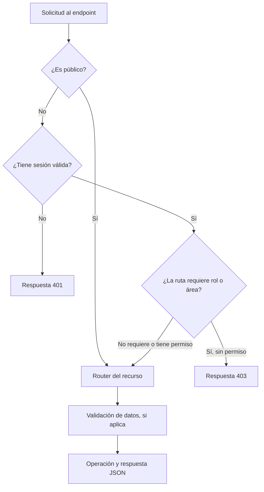

# 06 · Referencia de endpoints

Este documento reúne los endpoints disponibles en desarrollo y resume qué hace cada uno, qué acceso requiere y qué datos espera. Para probarlos localmente, usa la URL base `http://localhost:8000`.

Las respuestas se envían como JSON. Los endpoints marcados como **públicos** no requieren iniciar sesión; los demás usan la cookie de sesión `connect.sid`. Las rutas de Medicina y Nutrición requieren además acceso al área indicada. Las personas con rol `ADMIN` pueden acceder a ambas áreas.

## Cómo leer las tablas

- `sesión`: requiere haber iniciado sesión.
- `+priv`: requiere el rol `COORDINADOR` o `ADMIN`.
- `+área`: requiere acceso al área que indica el encabezado de la sección; `ADMIN` también puede acceder.
- `:id` representa el UUID del recurso.
- En las columnas **Datos** y **Respuesta**, `—` indica que no se documenta un cuerpo o parámetro específico para ese endpoint.

## Recorrido de una solicitud

Este esquema resume los controles generales. Los requisitos concretos de cada endpoint aparecen en las tablas de abajo.

## Autenticación · `/auth`

`login`, `forgot` y `reset` tienen límites de solicitudes propios (rate limit).

| Método  | Ruta                          | Acceso  | Datos (body o query)                             | Respuesta                                    |
| ------- | ----------------------------- | ------- | ------------------------------------------------ | -------------------------------------------- |
| `POST`  | `/auth/login`                 | Pública | `{ email, password }`                            | `{ ok: true }` y cookie de sesión.           |
| `GET`   | `/auth/me`                    | Sesión  | —                                                | `{ id, nombre, correo, foto, rol, area }`.   |
| `POST`  | `/auth/logout`                | Sesión  | —                                                | `{ ok: true }`.                              |
| `PATCH` | `/auth/password`              | Sesión  | `{ currentPassword, password, confirmPassword }` | `{ message }`.                               |
| `POST`  | `/auth/password/forgot`       | Pública | `{ correo }`                                     | `{ message }`.                               |
| `GET`   | `/auth/password/reset/:token` | Pública | Token en la ruta.                                | `{ correo }`, para mostrarlo en la pantalla. |
| `POST`  | `/auth/password/reset`        | Pública | `{ token, password, confirmPassword }`           | `{ message }`.                               |

## Usuarios · `/usuarios`

Los listados se filtran por área para quienes no son administradores.

| Método   | Ruta                 | Acceso  | Datos o comportamiento                                                                    |
| -------- | -------------------- | ------- | ----------------------------------------------------------------------------------------- |
| `POST`   | `/usuarios/registro` | Pública | Completa el registro usando `{ token, ... }` de una invitación.                           |
| `GET`    | `/usuarios`          | `+priv` | Query: `status`, `rol`, `sortBy`, `search`, `page`, `limit`. Responde `{ users, count }`. |
| `POST`   | `/usuarios`          | `+priv` | Crea un usuario.                                                                          |
| `GET`    | `/usuarios/:id`      | Sesión  | Consulta un usuario por UUID.                                                             |
| `PATCH`  | `/usuarios/:id`      | `+priv` | Actualiza un usuario; la desactivación respeta la jerarquía de roles.                     |
| `DELETE` | `/usuarios/:id`      | `+priv` | Soft-delete; respeta la jerarquía de roles.                                               |

## Invitaciones · `/invitaciones`

| Método   | Ruta                     | Acceso  | Qué hace                                                    |
| -------- | ------------------------ | ------- | ----------------------------------------------------------- |
| `GET`    | `/invitaciones/:token`   | Pública | Valida un token para la pantalla de registro.               |
| `POST`   | `/invitaciones`          | `+priv` | Emite una invitación con datos como `{ correo, rol, ... }`. |
| `POST`   | `/invitaciones/reenviar` | `+priv` | Reenvía el correo de una invitación.                        |
| `DELETE` | `/invitaciones`          | `+priv` | Elimina físicamente una invitación pendiente.               |

## Pacientes · `/pacientes`

| Método   | Ruta                   | Acceso | Datos o comportamiento                                                                                         |
| -------- | ---------------------- | ------ | -------------------------------------------------------------------------------------------------------------- |
| `GET`    | `/pacientes`           | Sesión | Query: `search`, `sortBy`, `genre`, `page`, `limit`. Responde `{ patients, count }`.                           |
| `POST`   | `/pacientes`           | Sesión | Crea un paciente.                                                                                              |
| `GET`    | `/pacientes/similares` | Sesión | Query: `nombre`, `apellidos`, `fecha_nacimiento`, `genero`. Busca candidatos de la otra área para sincronizar. |
| `GET`    | `/pacientes/:id`       | Sesión | Incluye `areas: [...]` con las áreas a las que pertenece el paciente.                                          |
| `PATCH`  | `/pacientes/:id`       | Sesión | Actualiza un paciente.                                                                                         |
| `DELETE` | `/pacientes/:id`       | Sesión | Soft-delete. Si el paciente pertenece a ambas áreas, solo un administrador puede eliminarlo.                   |

## Medicina · `/medicina`

Se requiere acceso al área de Medicina o el rol `ADMIN`.

| Método   | Ruta                              | Qué hace o qué datos requiere                                                                                          |
| -------- | --------------------------------- | ---------------------------------------------------------------------------------------------------------------------- |
| `POST`   | `/medicina/pacientes`             | Registra al paciente y su historia médica en una transacción. Acepta `pacienteId` para vincular un paciente existente. |
| `GET`    | `/medicina/historias-medicas`     | Lista historias por `?paciente_id=<uuid>`.                                                                             |
| `POST`   | `/medicina/historias-medicas`     | Crea una historia médica.                                                                                              |
| `GET`    | `/medicina/historias-medicas/:id` | Consulta una historia médica.                                                                                          |
| `PATCH`  | `/medicina/historias-medicas/:id` | Actualiza una historia médica.                                                                                         |
| `DELETE` | `/medicina/historias-medicas/:id` | Elimina una historia médica.                                                                                           |
| `GET`    | `/medicina/notas-evolucion`       | Lista notas por `?historia_medica_id=<uuid>`; el parámetro es obligatorio.                                             |
| `POST`   | `/medicina/notas-evolucion`       | Crea una nota de evolución.                                                                                            |
| `GET`    | `/medicina/notas-evolucion/:id`   | Consulta una nota de evolución.                                                                                        |
| `PATCH`  | `/medicina/notas-evolucion/:id`   | Actualiza una nota de evolución.                                                                                       |
| `DELETE` | `/medicina/notas-evolucion/:id`   | Elimina una nota de evolución.                                                                                         |
| `GET`    | `/medicina/emergencias`           | Consulta la bitácora de emergencias.                                                                                   |
| `POST`   | `/medicina/emergencias`           | Registra una emergencia en la bitácora.                                                                                |
| `GET`    | `/medicina/emergencias/:id`       | Consulta una emergencia.                                                                                               |
| `PATCH`  | `/medicina/emergencias/:id`       | Actualiza una emergencia.                                                                                              |
| `DELETE` | `/medicina/emergencias/:id`       | Elimina una emergencia.                                                                                                |

## Nutrición · `/nutricion`

Se requiere acceso al área de Nutrición o el rol `ADMIN`.

### Pacientes e historias

| Método   | Ruta                                 | Qué hace o qué datos requiere                                                                                                |
| -------- | ------------------------------------ | ---------------------------------------------------------------------------------------------------------------------------- |
| `POST`   | `/nutricion/pacientes`               | Registra al paciente y su historia de nutrición en una transacción. Acepta `pacienteId` para vincular un paciente existente. |
| `GET`    | `/nutricion/historias-nutricion`     | Lista historias por `?paciente_id=<uuid>`.                                                                                   |
| `POST`   | `/nutricion/historias-nutricion`     | Crea una historia de nutrición.                                                                                              |
| `GET`    | `/nutricion/historias-nutricion/:id` | Consulta una historia de nutrición.                                                                                          |
| `PATCH`  | `/nutricion/historias-nutricion/:id` | Actualiza una historia de nutrición.                                                                                         |
| `DELETE` | `/nutricion/historias-nutricion/:id` | Elimina una historia de nutrición.                                                                                           |

### Evaluaciones y seguimiento

El listado de cada recurso requiere `historia_paciente_id` (UUID). Las rutas de detalle usan el UUID del propio recurso.

| Recurso                                       | Ruta base                                | Operaciones                                            |
| --------------------------------------------- | ---------------------------------------- | ------------------------------------------------------ |
| Evaluación bioquímica                         | `/nutricion/evaluacion-bioquimica`       | `GET`, `POST`, `GET /:id`, `PATCH /:id`, `DELETE /:id` |
| Evaluación nutricional (frecuencia y hábitos) | `/nutricion/evaluacion-nutricional`      | `GET`, `POST`, `GET /:id`, `PATCH /:id`, `DELETE /:id` |
| Examinación física                            | `/nutricion/examinacion-fisica`          | `GET`, `POST`, `GET /:id`, `PATCH /:id`, `DELETE /:id` |
| Evaluación antropométrica                     | `/nutricion/evaluacion-antropometrica`   | `GET`, `POST`, `GET /:id`, `PATCH /:id`, `DELETE /:id` |
| Requerimientos (solo consulta)                | `/nutricion/cal-get-nutr`                | `GET`                                                  |
| Recordatorio de 24 horas                      | `/nutricion/rec-24h`                     | `GET`, `POST`, `GET /:id`, `PATCH /:id`, `DELETE /:id` |
| Calidad del sueño                             | `/nutricion/evaluacion-sueno`            | `GET`, `POST`, `GET /:id`, `PATCH /:id`, `DELETE /:id` |
| Actividad física                              | `/nutricion/evaluacion-actividad-fisica` | `GET`, `POST`, `GET /:id`, `PATCH /:id`, `DELETE /:id` |
| TPAN                                          | `/nutricion/tpan`                        | `GET`, `POST`, `GET /:id`, `PATCH /:id`, `DELETE /:id` |
| Reporte EEN                                   | `/nutricion/reporte-een`                 | `GET`, `POST`, `GET /:id`, `PATCH /:id`, `DELETE /:id` |

En los recursos CRUD, los endpoints de colección siguen este patrón:

| Método   | Ruta                                     | Uso                                                                          |
| -------- | ---------------------------------------- | ---------------------------------------------------------------------------- |
| `GET`    | `/<recurso>?historia_paciente_id=<uuid>` | Lista los registros asociados a la historia y devuelve `{ <items>, count }`. |
| `POST`   | `/<recurso>`                             | Crea un registro; responde `201` con `{ message, ... }`.                     |
| `GET`    | `/<recurso>/:id`                         | Consulta un registro.                                                        |
| `PATCH`  | `/<recurso>/:id`                         | Actualiza un registro.                                                       |
| `DELETE` | `/<recurso>/:id`                         | Elimina un registro.                                                         |

`/<recurso>` representa cualquiera de las rutas base CRUD de la tabla anterior. `/nutricion/cal-get-nutr` solo expone `GET`.

## Auditoría · `/audit`

| Método | Ruta         | Acceso  | Qué devuelve                       |
| ------ | ------------ | ------- | ---------------------------------- |
| `GET`  | `/audit`     | `+priv` | Listado de acciones con filtros.   |
| `GET`  | `/audit/:id` | `+priv` | Consulta un registro de auditoría. |

## Estadísticas · `/stats`

| Método | Ruta     | Acceso | Qué devuelve                                                                    |
| ------ | -------- | ------ | ------------------------------------------------------------------------------- |
| `GET`  | `/stats` | Sesión | Métricas del dashboard; para usuarios no administradores, se limitan a su área. |

## CIE-11 · `/icd11`

| Método | Ruta                  | Acceso | Qué devuelve                                                                |
| ------ | --------------------- | ------ | --------------------------------------------------------------------------- |
| `GET`  | `/icd11/search?q=...` | Sesión | Consulta la API de CIE-11 de la OMS y devuelve `[{ codigo, descripcion }]`. |

## Estado del servicio

| Método | Ruta      | Acceso  | Respuesta           |
| ------ | --------- | ------- | ------------------- |
| `GET`  | `/health` | Pública | `{ status: 'ok' }`. |
