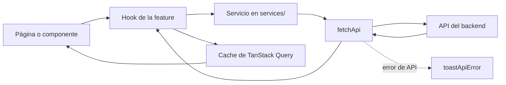

# 07 · Frontend

El frontend está construido con React 19 y Vite. Usa Tailwind CSS 4 para estilos, React Router 7 para navegación y TanStack Query 5 para los datos que se obtienen del backend. Los formularios usan `react-hook-form` y Zod; las notificaciones se muestran con Sonner.

## Cómo viajan los datos

Las páginas y componentes no hacen solicitudes HTTP directamente, llaman a hooks que usan servicios de `services/`; estos envían la solicitud mediante `fetchApi`. TanStack Query conserva los datos y actualiza la interfaz cuando una consulta o mutación termina.



## Organización e imports

Los imports del frontend usan estos alias, incluso cuando el archivo importado está en la misma carpeta. Evita las rutas relativas como `./X` o `../X`.

| Alias            | Carpeta o paquete                                 |
| ---------------- | ------------------------------------------------- |
| `@ui/*`          | Componentes de interfaz.                          |
| `@components/*`  | Componentes reutilizables.                        |
| `@features/*`    | Funcionalidades organizadas por dominio.          |
| `@pages/*`       | Páginas y vistas principales.                     |
| `@hooks/*`       | Hooks compartidos.                                |
| `@schemas/*`     | Esquemas propios de los formularios.              |
| `@lib/*`         | Utilidades compartidas del frontend.              |
| `@services/*`    | Comunicación con la API.                          |
| `@assets/*`      | Imágenes y otros recursos estáticos.              |
| `@cais/shared/*` | Esquemas y constantes compartidos con el backend. |

El diseño parte de escritorio. Para adaptar un componente a pantallas más pequeñas, usa las variantes `max-sm:`, `max-md:` o `max-lg:`. No uses `sm:`, `md:` o `lg:` para construir el diseño desde móvil hacia escritorio.

## Servicios de API

Los archivos de `services/` agrupan las llamadas a endpoints. Son wrappers delgados sobre `fetchApi`, con nombres en `camelCase`, por ejemplo `apiUsers.js` o `apiPatient.js`.

```js
import { fetchApi } from '@lib/fetchApi'

export async function getUsers({ status, search, page }) {
  const params = new URLSearchParams()
  if (status) params.append('status', status)
  if (search) params.append('search', search)
  if (page) params.append('page', page)
  const query = params.toString() ? `?${params}` : ''
  return fetchApi(`/usuarios${query}`, { errorMsg: 'Error al obtener los usuarios' })
}

export async function createUser(data) {
  return fetchApi('/usuarios', { method: 'POST', body: data, errorMsg: 'Error al crear usuario' })
}
```

`fetchApi` ya se encarga de incluir la cookie de sesión (`credentials: 'include'`), convertir el cuerpo a JSON y configurar `Content-Type`. Si el backend responde con un error, `fetchApi` lanza `ApiError` con el mensaje y los campos disponibles. No vuelvas a interpretar la respuesta manualmente: muestra los errores con `toastApiError(error)`, que también presenta los errores de campo como una lista.

## Datos del servidor con TanStack Query

La configuración global, en `main.jsx`, considera los datos recientes durante 5 minutos (`staleTime`) y conserva en caché los datos inactivos durante 10 minutos (`gcTime`). Para pedir datos del backend, usa TanStack Query; no combines `useEffect` con `fetch`.

### Claves de consulta

Usa claves predecibles para que sea sencillo identificar e invalidar cada conjunto de datos. Incluye los filtros en la clave cuando cambien el resultado:

| Datos                      | Clave de ejemplo                       |
| -------------------------- | -------------------------------------- |
| Lista de usuarios          | `['users']`                            |
| Usuario individual         | `['user', id]`                         |
| Lista de usuarios filtrada | `['users', status, rol, search, page]` |
| Lista de pacientes         | `['patients']`                         |

### Después de una mutación

Cuando una mutación modifica datos, invalida las consultas afectadas o actualiza su caché. En este ejemplo, tras crear un usuario se vuelve a consultar la lista:

```js
const { mutate } = useMutation({
  mutationFn: (data) => apiCreateUser(data),
  onSuccess: () => {
    toast.success('Usuario creado exitosamente')
    queryClient.invalidateQueries({ queryKey: ['users'] })
  },
  onError: toastApiError,
})
```

Para listados que cargan más resultados, reutiliza `useInfiniteList` y el componente `LoadMore` (botón «Cargar más» o scroll infinito). `useDebounce` ayuda a evitar búsquedas en cada pulsación. Hay más de 30 hooks en `features/<dominio>/hooks/`; revisa si ya existe uno antes de crear otro.

## Formularios y validación

La validación se reparte entre esquemas compartidos y esquemas que preparan los datos para los formularios:

| Esquema               | Ubicación                              | Responsabilidad                                                                                       |
| --------------------- | -------------------------------------- | ----------------------------------------------------------------------------------------------------- |
| Esquema compartido    | `@cais/shared/schemas/*`               | Define las reglas de validación usadas por el backend y el frontend. No las dupliques en el frontend. |
| Esquema de formulario | `@schemas/*` (`frontend/src/schemas/`) | Adapta el esquema compartido a los valores y controles del formulario.                                |

Un esquema de formulario puede, por ejemplo, aceptar objetos `dayjs` para los selectores de fecha, validar la confirmación de una contraseña u omitir campos que el formulario no captura.

```js
// frontend/src/schemas/medicalPatient.js
import { z } from 'zod'
import { patientSchema } from '@cais/shared/schemas/medicina/patient'
import { dayjsDateSchema } from '@cais/shared/schemas/fields'

export const medicalPatientFormSchema = z.object({
  ...patientSchema.shape,
  fecha_nacimiento: dayjsDateSchema,
})
```

Al implementar formularios:

- No declares `z.object(...)` ni importes Zod dentro de un componente o hook. Si la validación depende de valores en tiempo de ejecución, exporta una función factory desde `@schemas/`.
- Para formularios de varios pasos, usa `useStepForm` de `@hooks/`. Puedes consultar `features/patients/medicina/forms/MedicalPatientForm/` como ejemplo.
- Si el backend devuelve errores de campo en `error.fields`, asígnalos al formulario con `setError(field, { message })`.

## Fechas

El backend envía las fechas sin hora como `YYYY-MM-DD` y las fechas con hora como cadenas ISO. Consulta [03 · Base de datos y Prisma](./03-base-de-datos-y-prisma.md) para conocer el contrato completo.

Usa los helpers de `@lib/dateHelpers` para convertir y mostrar fechas. Evita pasar directamente los valores de la API a `dayjs()`, porque las fechas sin hora podrían interpretarse de forma distinta según la zona horaria.

| Helper                                             | Uso                                                                               |
| -------------------------------------------------- | --------------------------------------------------------------------------------- |
| `parseDate(value)`                                 | Convierte una fecha sin hora (`YYYY-MM-DD`) para usarla en un selector de fechas. |
| `parseDateTime(value)`                             | Convierte una fecha con hora (ISO).                                               |
| `formatFecha`, `formatFechaLong`, `formatRelativo` | Muestran fechas sin hora.                                                         |
| `formatHora`, `formatFechaHora`                    | Muestran fechas con hora.                                                         |

## Permisos en la interfaz

Las reglas de permisos están centralizadas. No revises `user.rol` o `user.area` directamente en cada componente: usa las utilidades existentes para que la misma regla se aplique de forma consistente.

| Pieza                      | Uso                                                                                                                                    |
| -------------------------- | -------------------------------------------------------------------------------------------------------------------------------------- |
| `@lib/permissions.js`      | Contiene `PERMISSIONS`, `can(user, perm)` y `canSeeRoute(user, route)`. Para agregar un permiso, añade su clave y su regla en `RULES`. |
| `@hooks/usePermissions.js` | Expone los permisos y datos de sesión a los componentes React.                                                                         |
| `@components/Can.jsx`      | Muestra contenido JSX solo cuando el usuario tiene el permiso indicado.                                                                |

El hook `usePermissions()` ofrece, entre otros, `can`, `isAdmin`, `isCoordinador`, `isPasante`, `isMedicina`, `isNutricion`, `area` y `user`. El valor `area` se normaliza a mayúsculas y coincide con las claves de `AREAS`; puede usarse para seleccionar una implementación según el área.

```jsx
const { can, isAdmin, area, user } = usePermissions()

<Can permission={PERMISSIONS.SEE_USER_AREA_COLUMN}>...</Can>
```

## Componentes y notificaciones

Antes de crear componentes nuevos, revisa los elementos reutilizables en `@components/`, como `Button`, `Input`, `Modal`, `Table`, `Tag`, `FormRow`, `Stepper` y `EmptyState`.

| Necesidad                | Convención existente                                                                   |
| ------------------------ | -------------------------------------------------------------------------------------- |
| Variantes de componentes | Usa `cva` junto con el helper `cn`.                                                    |
| Diálogos                 | Compón `<Modal>` con `<Modal.Open>` y `<Modal.Content>`.                               |
| Notificaciones           | Usa Sonner. Para errores de API, llama a `toastApiError(error)` desde `@lib/ApiError`. |
