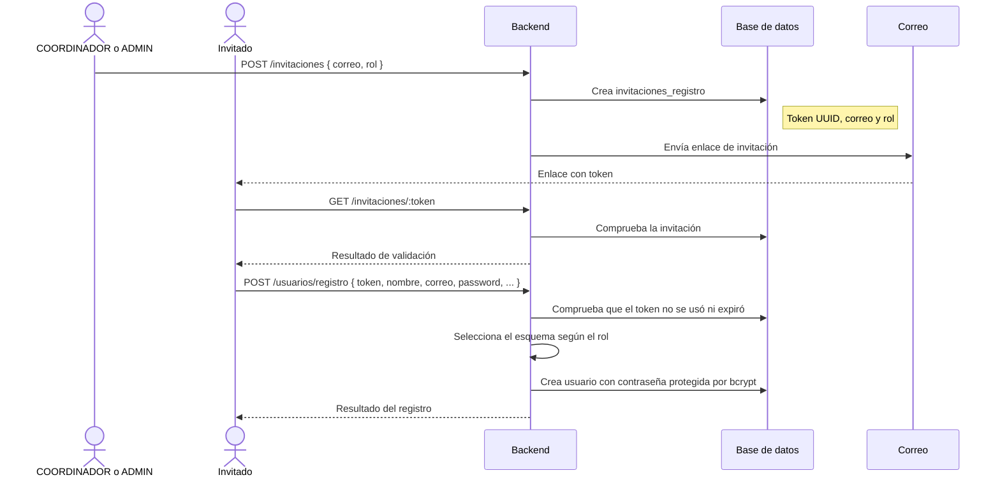
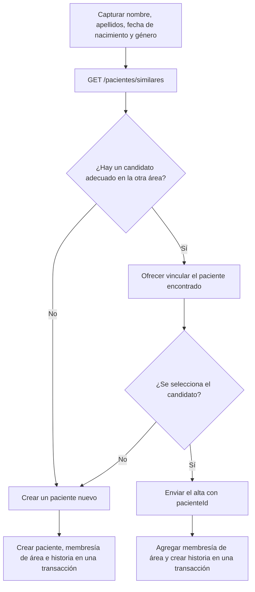
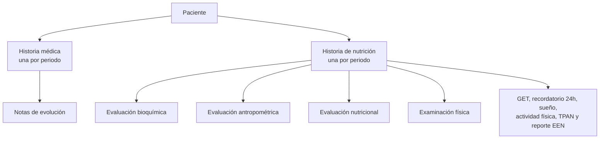
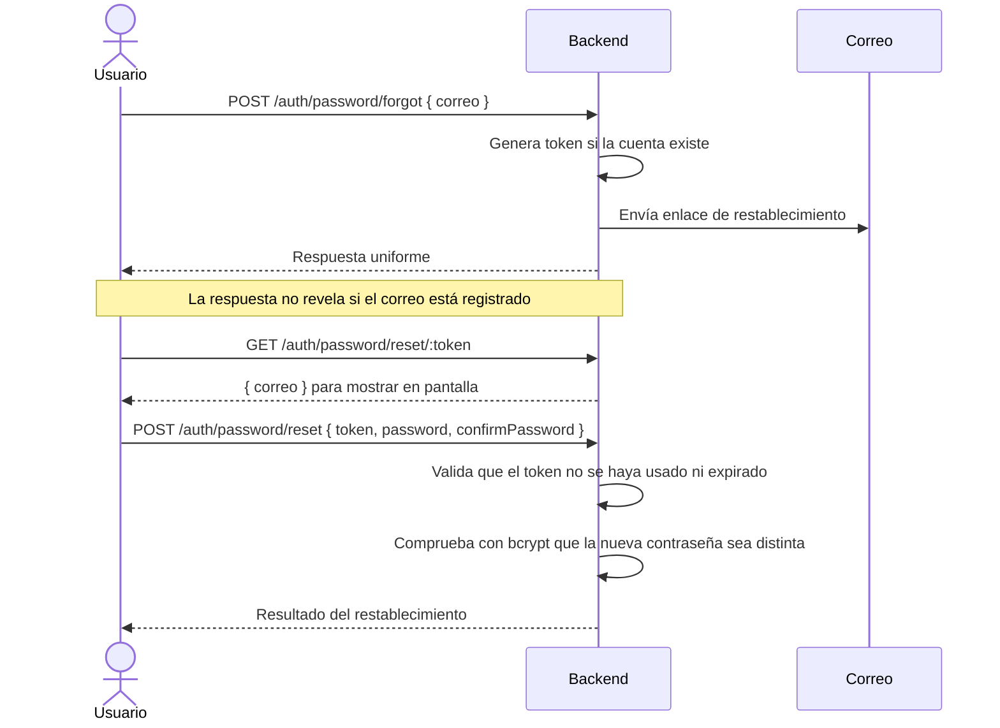
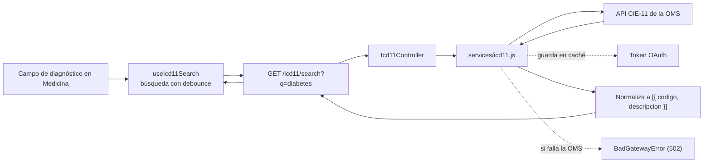

# 08 · Flujos clave

Este documento recorre cinco procesos importantes del sistema: el alta por invitación, el registro de pacientes compartidos entre áreas, la relación entre historias y sus sub-recursos, la recuperación de contraseña y la búsqueda de diagnósticos CIE-11.

Cada proceso conecta varias partes del sistema. Usa estos recorridos como guía cuando cambies una ruta, un servicio, una regla de negocio o la interfaz relacionada.

## 1. Registro de usuario por invitación

El sistema no permite el registro abierto. Una persona con rol `COORDINADOR` o `ADMIN` envía una invitación; quien la recibe completa el registro con el token incluido en el enlace.

`POST /usuarios/registro` es público y debe estar registrado antes del middleware `requireAuth`.

## 2. Registro de paciente y sincronización entre áreas

Un paciente puede recibir atención en Medicina y Nutrición. La tabla puente `pacientes_areas` registra las áreas asociadas. El alta inicial guarda al paciente, la membresía del área y su primera historia dentro de una sola transacción.

El mismo endpoint permite agregar un paciente existente a la otra área:

| Solicitud        | Qué hace                                                                                                            |
| ---------------- | ------------------------------------------------------------------------------------------------------------------- |
| Sin `pacienteId` | Crea el paciente, lo asocia al área del usuario y crea su primera historia médica o de nutrición.                   |
| Con `pacienteId` | Agrega el área y crea allí una historia. No reemplaza los datos personales existentes; solo completa campos vacíos. |

Los endpoints de alta son `POST /medicina/pacientes` y `POST /nutricion/pacientes`. Ambos reciben los datos del paciente, los datos de la historia y, cuando se sincroniza, `pacienteId`.

### Cómo se encuentra un paciente existente

Al capturar nombre, apellidos, fecha de nacimiento y género, el frontend puede consultar `GET /pacientes/similares` para buscar candidatos de la otra área. La fecha debe coincidir exactamente; el nombre se compara con un score de similitud. Si la persona selecciona un resultado, el alta se envía con su `pacienteId`.

La búsqueda compara la fecha de nacimiento con coincidencia exacta. Consulta el contrato de fechas en [03 · Base de datos y Prisma](./03-base-de-datos-y-prisma.md).

### Vista de detalle

`GET /pacientes/:id` incluye `areas: [...]`, que indica a qué áreas pertenece el paciente. La interfaz presenta esa información según el rol:

| Usuario               | Presentación                                                                                              |
| --------------------- | --------------------------------------------------------------------------------------------------------- |
| `ADMIN`               | Muestra `AreaSwitcher` con las áreas del paciente. Si solo pertenece a una, muestra una pestaña estática. |
| Pasante o coordinador | Muestra el aviso «También es paciente en …» cuando el paciente está registrado en otra área.              |

## 3. Historias clínicas y sub-recursos

Cada área tiene su propia historia clínica. Las notas y evaluaciones se asocian a esa historia, que a su vez pertenece a un paciente.

Al mantener estos recursos, ten en cuenta las siguientes reglas:

| Regla                                               | Qué implica                                                                                                                                                                                 |
| --------------------------------------------------- | ------------------------------------------------------------------------------------------------------------------------------------------------------------------------------------------- |
| El sub-recurso pertenece a una historia.            | En Nutrición usa `historia_paciente_id`; en Medicina, `historia_medica_id`. El `paciente_id` se obtiene desde la historia mediante `formatX`; no se guarda de nuevo ni se envía en el body. |
| Los listados se filtran por historia.               | La consulta requiere el UUID de la historia. Así se evita devolver registros de otros pacientes.                                                                                            |
| Solo se crean sub-recursos en historias activas.    | Los guards de `#lib/historyGuard.js` comprueban que la historia no tenga soft-delete.                                                                                                       |
| El borrado lógico de una historia oculta sus hijos. | Se aplica un relation filter; no se marca cada hijo como eliminado.                                                                                                                         |

## 4. Cambio y recuperación de contraseña

Hay dos recorridos: cambiar la contraseña desde una sesión activa o restablecerla con un enlace enviado por correo.

### Cambio con sesión

Desde la configuración, el usuario envía `PATCH /auth/password` con `currentPassword`, `password` y `confirmPassword`. El backend verifica la contraseña actual con bcrypt, comprueba que la nueva sea distinta y regenera la sesión.

### Recuperación sin sesión

Los endpoints `POST /auth/password/forgot`, `GET /auth/password/reset/:token` y `POST /auth/password/reset` tienen rate limit.

## 5. Búsqueda de diagnósticos CIE-11

Los códigos no están almacenados en el frontend. La interfaz consulta al backend, que actúa como intermediario de la API CIE-11 de la Organización Mundial de la Salud (OMS).

El frontend consume los resultados mediante el hook `useIcd11Search`, que retrasa las consultas mientras la persona escribe. Se usa en los campos de diagnóstico de Medicina. Si la API de la OMS falla, el backend responde con `BadGatewayError` (502).
