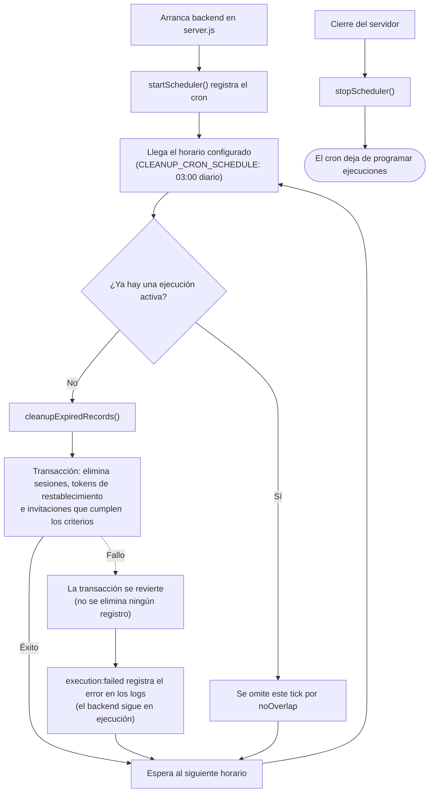

# 09 · Scheduler de limpieza

El backend ejecuta periódicamente una tarea que elimina sesiones y registros de autenticación que ya no se necesitan. La tarea limpia sesiones vencidas, tokens de restablecimiento de contraseña y invitaciones expiradas o usadas.

Los registros de `registro_auditoria` no se eliminan con este proceso: su propósito es conservar el historial de acciones.

## Archivos relacionados

| Archivo                                     | Responsabilidad                                                                    |
| ------------------------------------------- | ---------------------------------------------------------------------------------- |
| `backend/src/jobs/cleanupExpiredRecords.js` | Ejecuta en una transacción los tres `deleteMany` de limpieza.                      |
| `backend/src/jobs/scheduler.js`             | Programa la tarea con `node-cron` y expone `startScheduler()` y `stopScheduler()`. |
| `backend/src/server.js`                     | Inicia el scheduler al arrancar el servidor y lo detiene durante el cierre.        |
| `backend/src/lib/constants.js`              | Define `CLEANUP_CRON_SCHEDULE` y `USED_TOKEN_GRACE_MS`.                            |

## Qué registros se eliminan

La función `cleanupExpiredRecords.js` compara las fechas con la hora actual. Los tokens usados tienen un periodo de gracia de 24 horas antes de poder eliminarse por antigüedad.

| Tabla                   | Criterio de eliminación                                                                                                      |
| ----------------------- | ---------------------------------------------------------------------------------------------------------------------------- |
| `sessions`              | La sesión venció (`expire < ahora`).                                                                                         |
| `password_reset_tokens` | El token venció (`expira_at < ahora`) o fue usado y tiene más de 24 horas (`created_at < ahora - USED_TOKEN_GRACE_MS`).      |
| `invitaciones_registro` | La invitación venció (`expira_at < ahora`) o fue usada y tiene más de 24 horas (`created_at < ahora - USED_TOKEN_GRACE_MS`). |

La expiración y el periodo de gracia son criterios distintos: un registro se elimina al vencer o, si fue usado, cuando supera las 24 horas de antigüedad. `registro_auditoria` queda fuera de esta limpieza.

## Horario de ejecución

`CLEANUP_CRON_SCHEDULE` está definido como `'0 3 * * *'`, es decir, todos los días a las 3:00 a. m. Las sesiones y los tokens vencidos dejan de ser válidos por sí mismos, así que la limpieza periódica sirve para retirar sus filas sin tener que ejecutarla continuamente.

El scheduler usa `node-cron` con `{ noOverlap: true }`. Si una ejecución sigue activa cuando llega el siguiente horario, esa nueva ejecución se omite en lugar de quedar en espera.

## Ciclo de vida



## Dónde se ejecuta

El scheduler se inicia desde `server.js`, que es el proceso de backend que atiende la aplicación. No se inicia en los tests: Jest importa `app.js`, no `server.js`, y tampoco se ejecuta al levantar la aplicación únicamente con `supertest`.

En la configuración actual hay un solo proceso backend en `compose.yml`, así que no se requiere coordinación entre instancias. Si el backend se escala horizontalmente, agrega un mecanismo de locking antes de ejecutar varias instancias. Se puede usar `{ distributed: true }` de `node-cron` o implementar un lock propio.

## Cómo probar la limpieza en desarrollo

El scheduler espera al siguiente tick configurado. Con `'0 3 * * *'`, la espera puede ser de hasta 24 horas. Para probarlo antes, puedes adelantar temporalmente el cron o ejecutar directamente la función.

### Opción 1: adelantar el cron

1. Cambia temporalmente `CLEANUP_CRON_SCHEDULE` a `'* * * * *'` en `backend/src/lib/constants.js` para que se ejecute cada minuto.
2. El backend de desarrollo usa `--watch-path=src` y se reinicia al guardar el cambio.
3. Comprueba el resultado en los logs del backend.
4. Restaura el valor `'0 3 * * *'` antes de hacer commit.

### Opción 2: ejecutar la función directamente

Desde la raíz del repositorio:

```bash
cd backend
node --env-file-if-exists=../.env -e "
import('#jobs/cleanupExpiredRecords.js').then(async (m) => {
  console.log(await m.cleanupExpiredRecords())
  process.exit(0)
})
" --input-type=module --conditions=node
```

El seed incluye una invitación vencida para probar el caso de expiración:

```text
invitaciones_registro.correo = 'pasante.expirado@uabc.edu.mx'
```

## Manejo de errores

Si la tarea falla, el scheduler captura el error y lo registra mediante `.on('execution:failed', ...)` en `scheduler.js`. El fallo no detiene el proceso del backend. Si parece que la limpieza dejó de ejecutarse, revisa los logs del backend.
